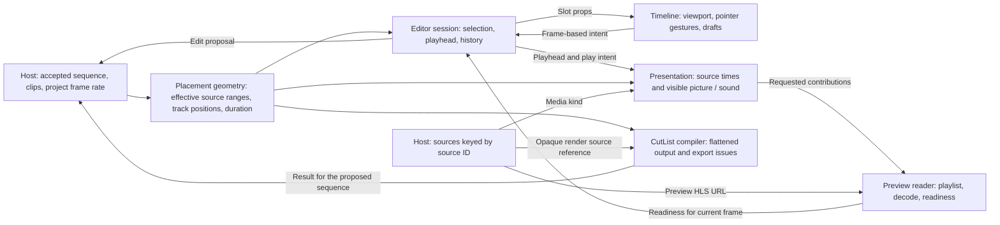
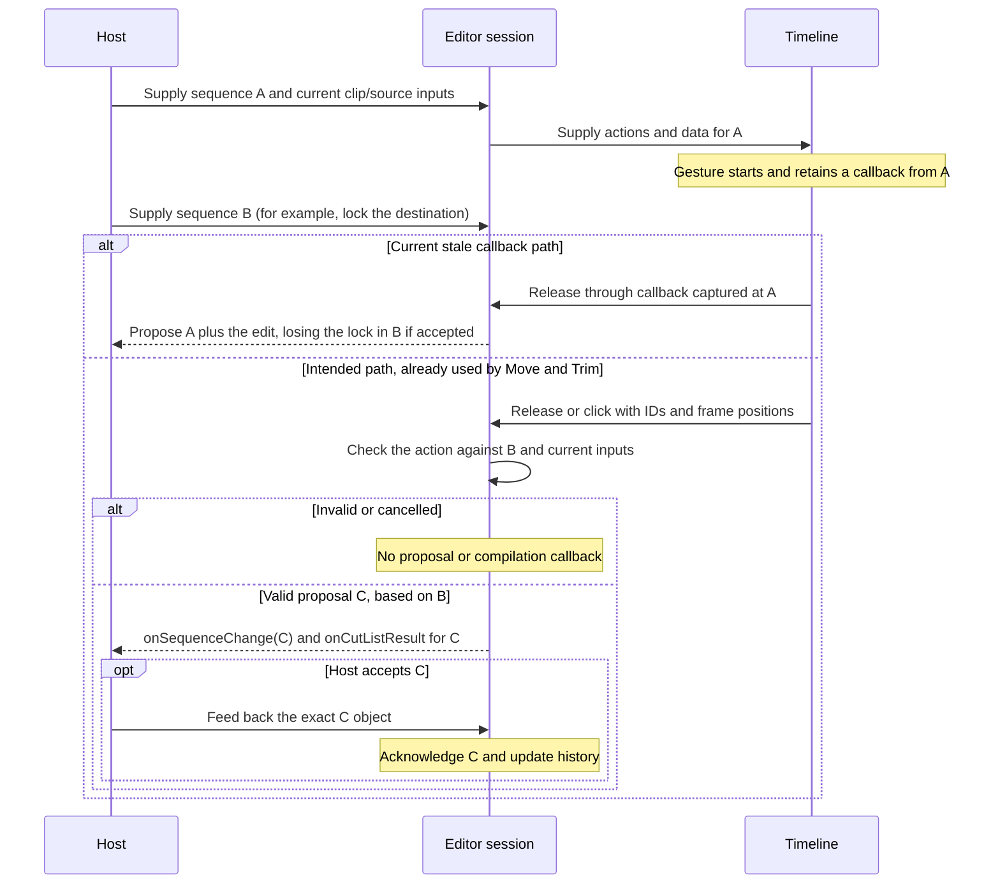
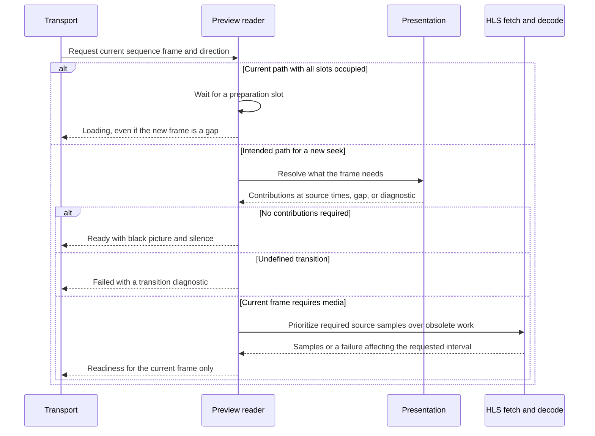

# Sequence editor data flow

This guide shows which inputs each part of the editor owns and where the
[review follow-ups](../.scratch/sequence-editor/TRIAGE.md#branch-review-follow-ups)
would change the current flow. See the [sequence editor design](sequence-editor-design.md)
for the behavior contract.

## What flows where

The arrows describe responsibilities, not required shared functions. The
compiler and Preview can reach different conclusions about the same valid edit:
a gap or dissolve can be previewable even when the output format cannot express
it. The Inspector describes the authored edit and its resolved contributions,
not whether the whole sequence can export. Neither Preview nor authoring
should use compiler success as a prerequisite for valid placement geometry.

`VideoClip.sourceId` selects a source record; it isn't a render reference.
`previewHlsUrl` tells the browser where to fetch Preview media. `s3Location`
is the current field for the opaque reference passed to the renderer; the
host decides what its value means. The compiler should preserve any supplied
string, including `""`, and report a missing value instead of substituting
the source ID or the Preview URL. The
[render reference ticket](../.scratch/sequence-editor/issues/91-require-a-render-source-reference.md)
tracks the missing-value case without renaming the field.

## From a gesture to a host-accepted edit

- A callback or drag draft is not a copy of the host's persistent state. See
  [retained Timeline actions](../.scratch/sequence-editor/issues/83-revalidate-remaining-timeline-actions.md).
- Invalid authored inputs are reported to the host. An invalid **candidate**
  (for example, a pool drop beyond the source end) should be rejected before an
  edit proposal. A valid edit with an export issue still produces both callbacks.
- Undo and Redo currently store accepted **sequence** snapshots, not clip or
  source snapshots. If the host removes a clip, a history target that references
  it may no longer be valid. The
  [history ticket](../.scratch/sequence-editor/issues/87-define-history-after-clip-changes.md)
  leaves the history policy open; it should not silently restore a dangling
  placement or take ownership of changing the host's clip pool.

## From the playhead to decoded media

Presentation resolves *what* to play; the reader fetches and decodes it. The
session still owns *when* to advance. The
[seek scheduling ticket](../.scratch/sequence-editor/issues/92-prioritize-the-current-preview-seek.md)
tracks queue behavior without changing the cache budget or the session clock.
The target host supplies a direct HLS media playlist for each playback
rendition. A [multivariant playlist](../GLOSSARY.md#language) lists alternative
streams rather than media segments; choosing among those streams is
[out of scope](../.scratch/sequence-editor/issues/93-clarify-hls-variant-contributions.md).
