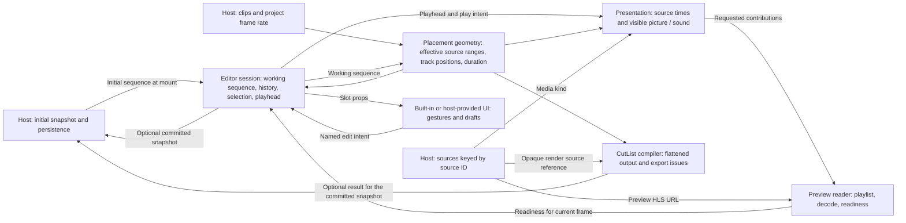
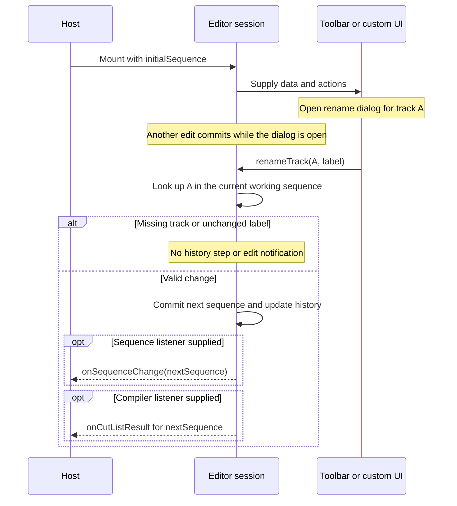
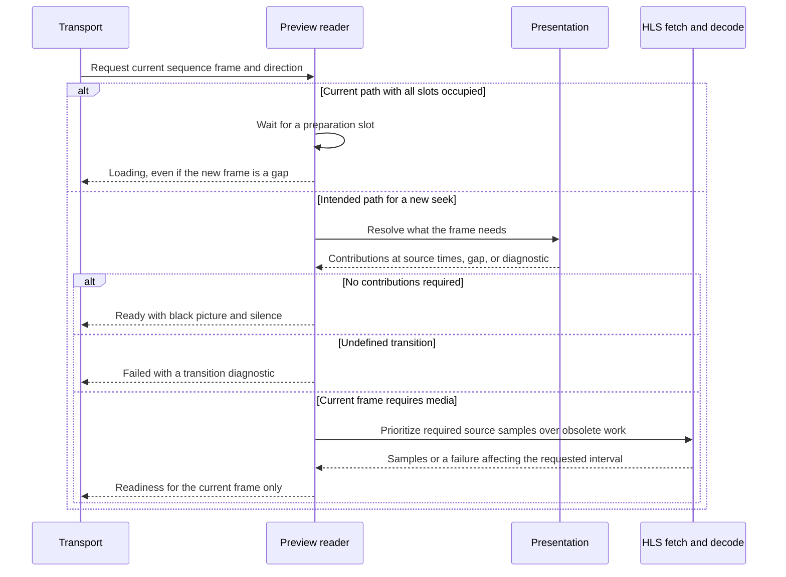

# Sequence editor data flow

The first two diagrams describe the agreed session ownership design, which
replaces the current controlled sequence flow when implemented. See the
[sequence editor design](sequence-editor-design.md) for the contract and
[branch review follow-ups](../.scratch/sequence-editor/TRIAGE.md#branch-review-follow-ups)
for outstanding work.

## What flows where

The arrows describe responsibilities, not required shared functions. The
compiler and Preview can reach different conclusions about the same valid edit:
a gap or dissolve can be previewable even when the output format cannot express
it. The Inspector describes the authored edit and its resolved contributions,
not whether the whole sequence can export. Neither Preview nor authoring
should use compiler success as a prerequisite for valid placement geometry.

`VideoClip.sourceId` selects a source record; it isn't a render reference.
`previewHlsUrl` tells the browser where to fetch Preview media. `s3Location`
is the current field for the opaque reference passed to the renderer; the
host decides what its value means. The compiler should preserve any supplied
string, including `""`, and report a missing value instead of substituting
the source ID or the Preview URL. The
[render reference ticket](../.scratch/sequence-editor/issues/91-require-a-render-source-reference.md)
tracks the missing-value case without renaming the field.

## From UI intent to a committed edit

- The host can save a snapshot immediately, later, or not at all. The session
  keeps editing without save feedback. A rerender is not a reload; changing
  the React key mounts a new session and clears editor state.
- Release revalidates a gesture against current state, even if its preview
  was valid. Invalid inputs to the current sequence have a separate diagnostic
  callback. An invalid action or history target produces no edit notification.
  A valid edit with an export issue still notifies both listeners if supplied.
- Undo and Redo restore sequence snapshots, not clips or sources. Refuse an
  invalid history target without consuming it. See the
  [history policy](sequence-editor-design.md#action-intent-and-history).

### From a gesture to a host-accepted edit

In the current controlled implementation, actions propose a new sequence and
the host echoes the exact object to advance history. The closed
[retained Timeline actions ticket](../.scratch/sequence-editor/issues/83-revalidate-remaining-timeline-actions.md)
describes revalidation when a host replacement lands during a gesture.
In the agreed design, an intervening local edit exercises the same rule.

## From the playhead to decoded media

Presentation resolves *what* to play; the reader fetches and decodes it. The
session still owns *when* to advance. The
[seek scheduling ticket](../.scratch/sequence-editor/issues/92-prioritize-the-current-preview-seek.md)
tracks queue behavior without changing the cache budget or the session clock.
The target host supplies a direct HLS media playlist for each playback
rendition. A [multivariant playlist](../GLOSSARY.md#language) lists alternative
streams rather than media segments; choosing among those streams is
[out of scope](../.scratch/sequence-editor/issues/93-clarify-hls-variant-contributions.md).
